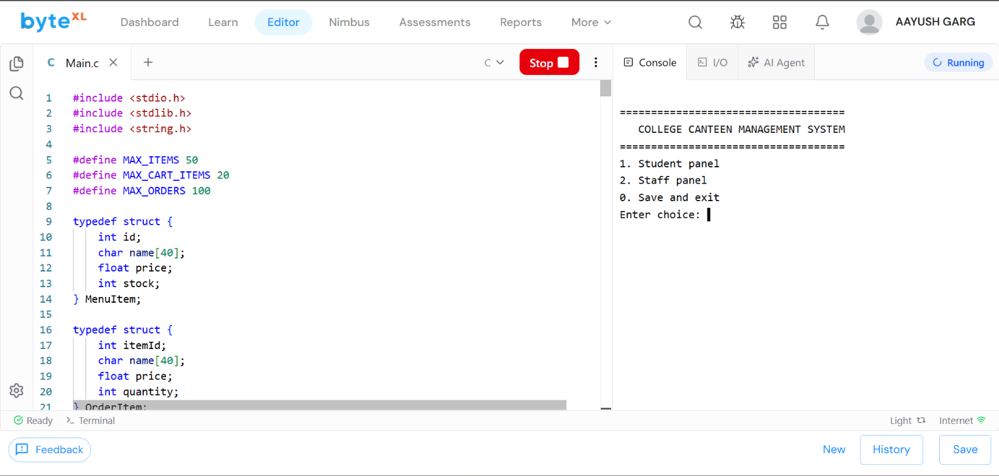
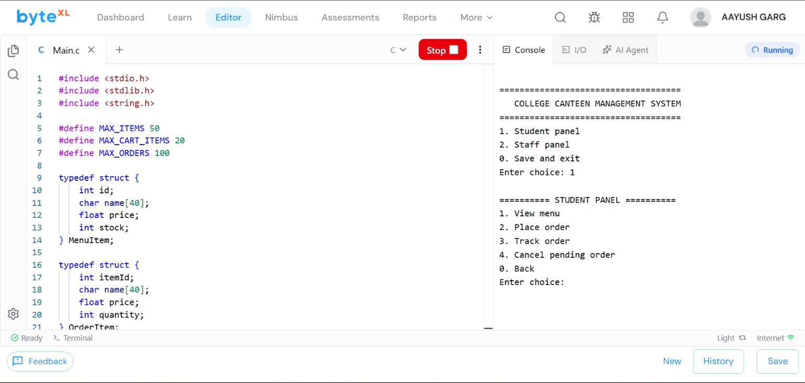
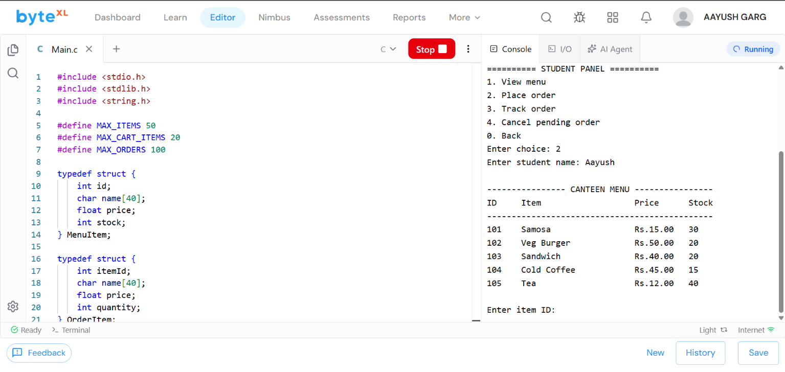
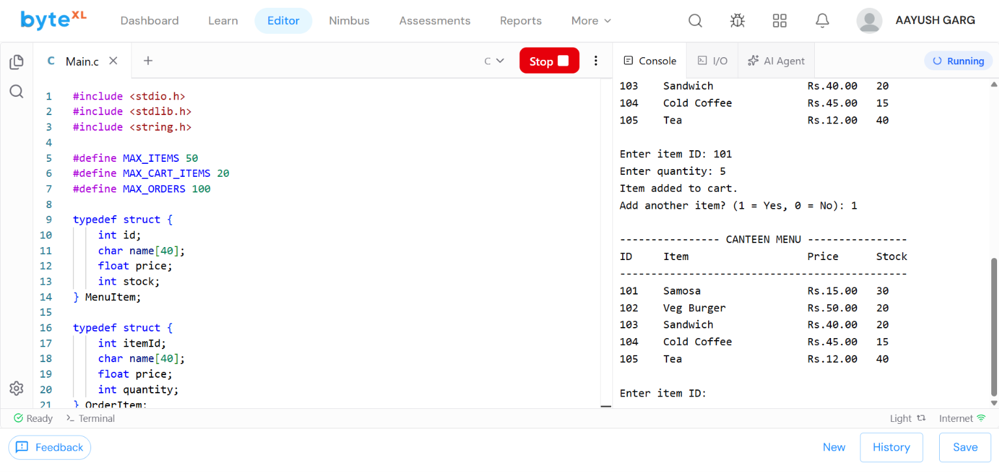
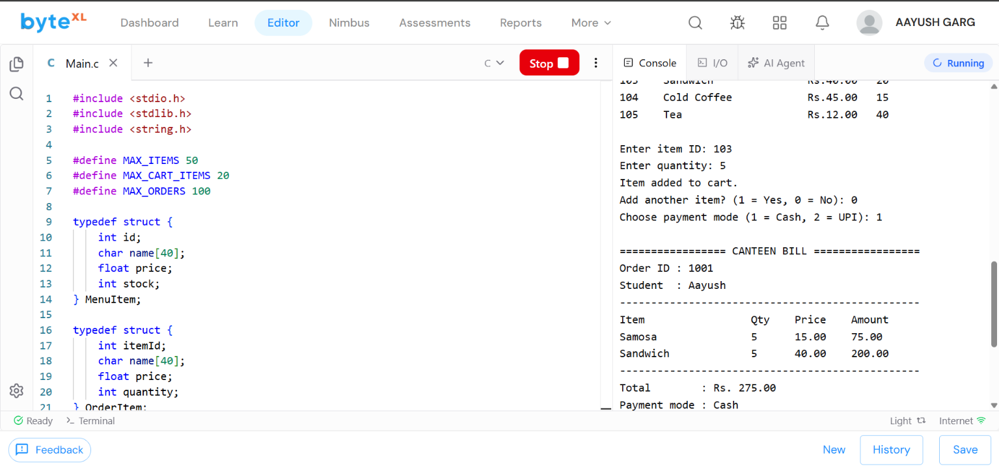
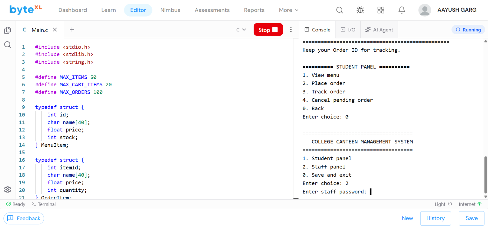
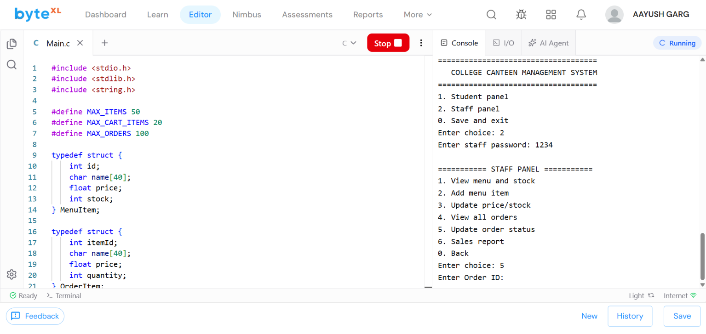
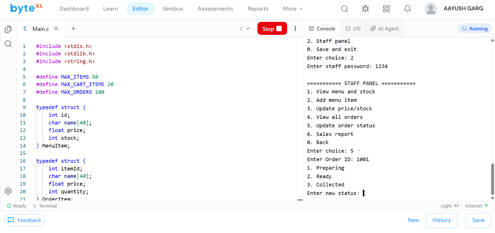
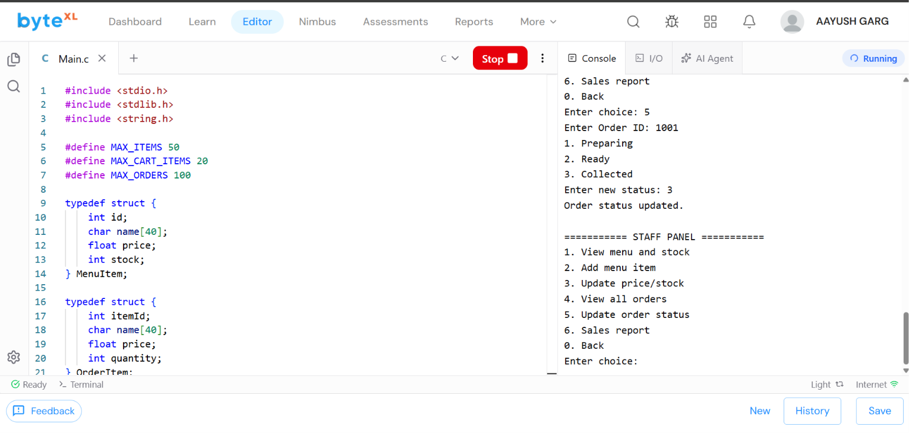

# CampusBite — College Canteen Management System

CampusBite is a menu-driven college canteen management project written in standard C. It allows students to view the menu, place and track orders, generate bills, choose cash or UPI, and cancel pending orders. Staff can manage menu items and stock, update order status, view orders, and check completed sales.

## How the program works

1. The program starts with separate Student and Staff panels.
2. A student can view the menu, enter an item ID and quantity, and add multiple items to the cart.
3. CampusBite calculates the total, records the payment mode, generates an order ID, and prints the bill.
4. The selected quantities are automatically removed from the available stock.
5. Staff members sign in with the password and can update an order to Preparing, Ready, or Collected.
6. Menu, stock, and order details are saved in files so they remain available when the program is opened again.

## Features

- Separate student and staff panels
- Menu display with item ID, price, and available stock
- Multiple items in one order
- Automatic bill and unique order ID generation
- Cash and UPI payment options
- Order tracking: Pending, Preparing, Ready, and Collected
- Pending-order cancellation with automatic stock restoration
- Staff controls for adding items and updating prices or stock
- Completed sales report
- File handling to preserve menu, stock, and order data

## C concepts used

- Variables, operators, conditions, and loops
- Arrays and strings
- Functions and pointers
- Structures
- File handling with binary files
- Preprocessor directives and macros

## Compile and run

### Windows (GCC/MinGW)

```cmd
gcc campusbite.c -o campusbite.exe
campusbite.exe
```

### Linux or macOS

```bash
gcc -std=c11 -Wall -Wextra campusbite.c -o campusbite
./campusbite
```

The staff-panel password is `1234`.

The program creates `menu.dat` and `orders.dat` in the current folder when it runs. These files store the menu, stock, and order records.

## Main menu

```text
1. Student panel
2. Staff panel
0. Save and exit
```

## Working demonstration

### 1. CampusBite starts successfully



The program has compiled and is running. It displays the main menu where the user can open the Student panel, open the Staff panel, or save and exit.

### 2. Opening the Student panel



The user selects option `1`. The Student panel provides options to view the menu, place an order, track an existing order, or cancel a pending order.

### 3. Starting a new order



The student selects Place order, enters the name `Aayush`, and receives the available menu with item IDs, prices, and current stock.

### 4. Adding the first item



Item ID `101` is selected with a quantity of `5`, adding five samosas to the cart. The student chooses to add another item.

### 5. Generating the bill



Five sandwiches are added using item ID `103`. After Cash is selected, CampusBite generates Order ID `1001` and calculates the bill: Rs.75 for samosas plus Rs.200 for sandwiches, giving a total of Rs.275.

### 6. Opening the Staff panel



The student order is complete. The user returns to the main menu and opens the protected Staff panel to manage the order.

### 7. Selecting an order for updating



After entering the staff password, the staff member selects Update order status and enters Order ID `1001`.

### 8. Marking the order as collected



The system offers Preparing, Ready, and Collected states. Option `3` is selected to record that the student has collected the order.

### 9. Successful status update



CampusBite confirms that the order status was updated and returns to the Staff panel. The completed order can now be included in the sales report.

## Project limitations

This is a terminal-based academic project. Payment selection is recorded for demonstration; it does not connect to a real payment gateway. The sales report includes orders marked as Collected.

## Author

Aayush Garg
